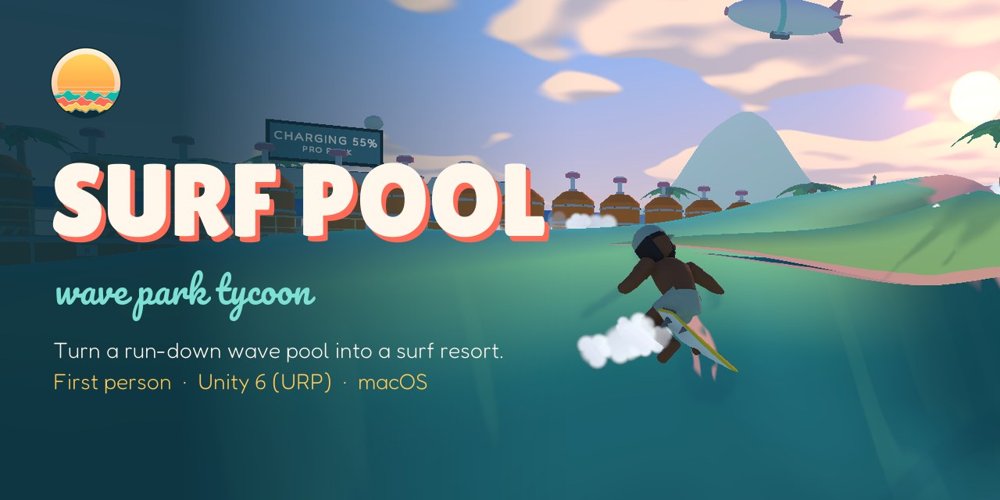
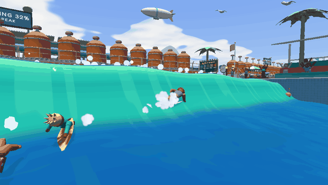
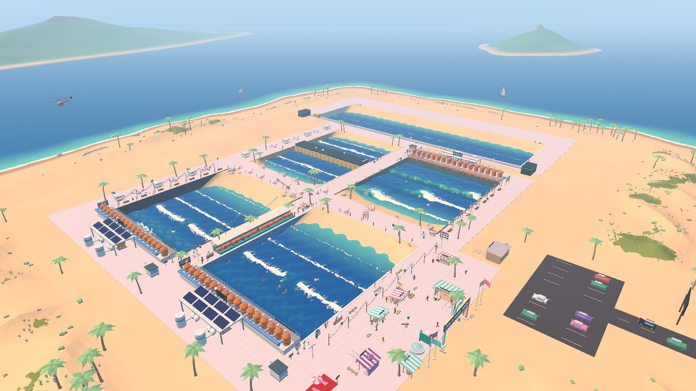
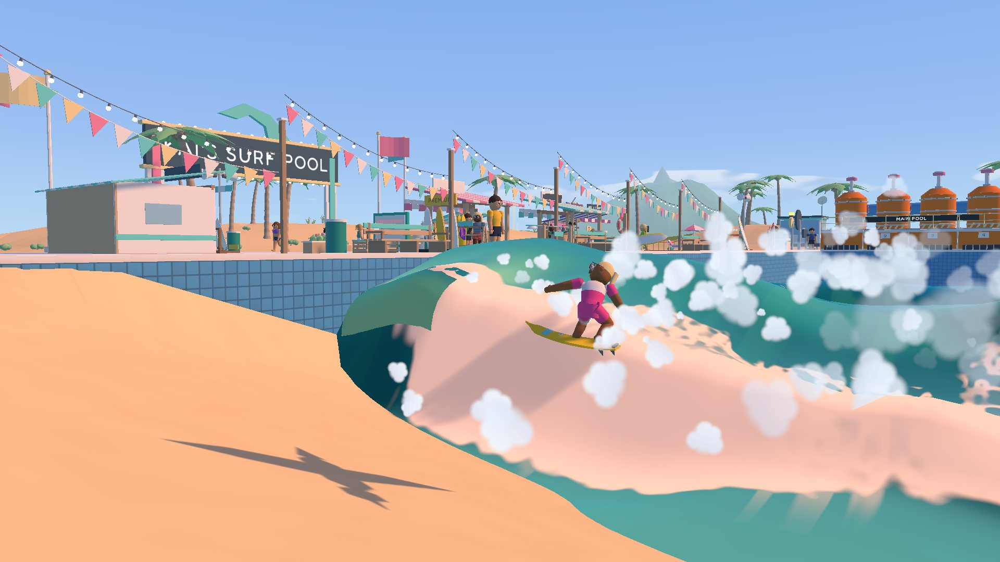
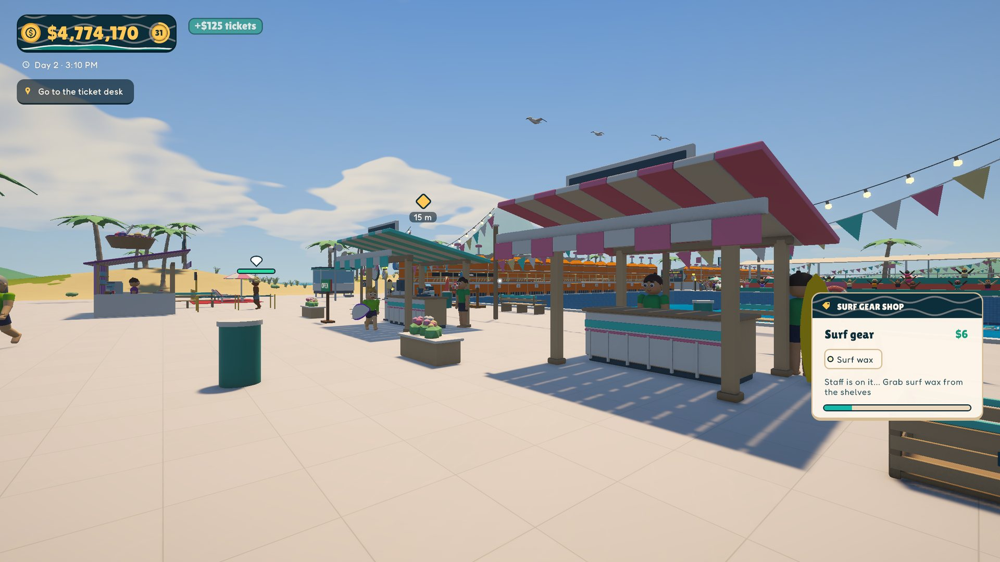
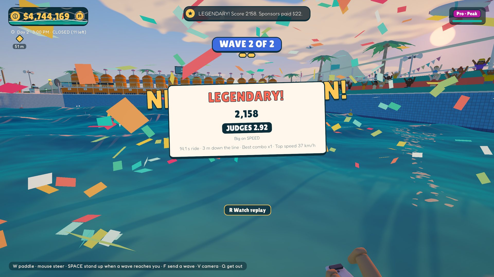
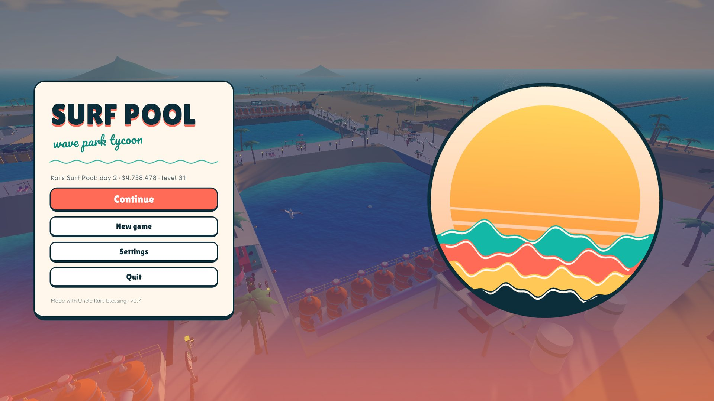
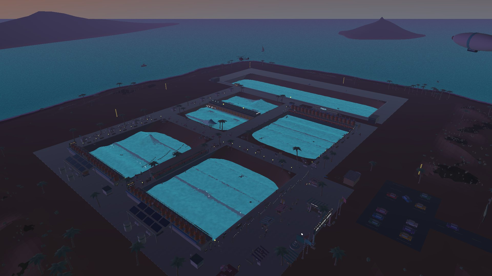

  

  <b>A first-person wave pool tycoon.</b> Inherit your uncle's run-down surf pool, sell sessions, fire the waves, 
  keep the surfers stoked, and grow it into a five-zone surf resort. Then paddle out and ride it yourself.

  <a href="https://github.com/Idosiloni/surfpool/releases/latest"><b>⬇ Download for Mac or Windows</b></a>
  &nbsp;·&nbsp; <a href="#play-from-source">Run from source</a>
  &nbsp;·&nbsp; <a href="#how-its-made">How it's made</a>

  

---

## The game

You walk your park in first person and do every job yourself at first: ring up sessions at the ticket desk, hand out rental boards, press the button that fires the wave, sweep the deck, scoop junk out of the pool. As the money comes in you hire staff, automate the chores, and build bigger and stranger pools, until the park runs itself and you can go surfing.

<table>
  <tr>
    <td></td>
    <td></td>
  </tr>
  <tr>
    <td></td>
    <td></td>
  </tr>
  <tr>
    <td></td>
    <td></td>
  </tr>
</table>

### Run the park
- **Five wave zones** in one connected basin: the Main Pool (it grows from 40×30 to 60×50 m), the Reef, the Big Wave zone, the Cove (rights on one side of a paddle pier, lefts on the other) and a 150 m Surf Ranch strip with a foil on a rail.
- **Wave control:** pick the level (beginner / intermediate / pro), the shape (mellow, standard, hollow), the direction, the set size, or a famous-wave preset.
- **Counter shops you work by hand:** blend açaí bowls from topping tubs, ring up surf gear item by item, shape custom boards (plane, spray, fins), until you hire someone to do it.
- **Staff with stars, upgrades you can see** (every upgrade adds a prop), park levels with pick-1-of-3 perks, and luxury tiers that turn concrete into boardwalk, sandstone and marble as you get rich.
- **Real customer life:** surfers with names, personalities and written reviews; rush-hour surf-camp buses; sneak-ins, wave hogs and shoplifters to throw out; beginners to rescue with a ring buoy; litter, dirty pools and machine breakdowns.
- **A story:** Uncle Kai's letters across six chapters, a rival park owner, visiting surf legends, and a finale on the Surf Ranch.

### Surf it
- Boards ride the actual wave surface: dropping down the face gives speed, climbing trades it for height, the whitewater bogs you down. The same physics drives you and every NPC.
- Carves, cutbacks, snaps, floaters, pumping, tube rides and (on pro waves) airs with spins and grabs, scored by judges with combos, a flow meter and a score card.
- A quiver of shortboard, foamie, longboard (walk to the nose to hang ten) and fish, a chase cam, an instant replay, and a photographer on a tower who sells prints of the best shots.

## Controls

| | |
|---|---|
| Move / look | `WASD` + mouse, `Shift` run, `Space` jump |
| Use / work | `E` or left click (hold for blending, shaping, planing) |
| Journal · peek at the full HUD · hide HUD | `J` · hold `Alt` · `H` |
| Pause / settings | `Tab` |
| Build mode | `B` (`R` rotate, `X` remove) |
| Surfing | `W` paddle, `Space` pop up, `WASD` points the board, `Shift` grab, `Space` air, `F` send a wave, `V` camera, `R` replay, `Q` get out |

## Play the build

Download the zip for your computer from the [latest release](https://github.com/Idosiloni/surfpool/releases/latest) and unzip it.

**Mac** (`SurfPool-…-mac.zip`, Apple Silicon M1 or newer):
the app isn't notarized by Apple, so the first launch needs one extra step: right-click **Surf Pool.app** → **Open** → **Open**.
On newer macOS, if it says it can't be opened, go to **System Settings → Privacy & Security** and click **Open Anyway**.
If macOS says the app "is damaged", run `xattr -cr "/path/to/Surf Pool.app"` once in Terminal.

**Windows** (`SurfPool-…-windows.zip`, Windows 10/11, 64-bit):
unzip the whole folder first, then run **Surf Pool.exe**. The game isn't signed, so Windows may show "Windows protected your PC": click **More info** → **Run anyway**.

## Play from source

1. Install **Unity 6000.6.6f1** with Unity Hub (add *Mac Build Support* / *Windows Build Support (Mono)* to build).
2. Clone this repo and open the folder in Unity Hub.
3. Open `Assets/_Game/Scenes/Pool.unity` and press Play.

Useful editor menus live under **Surf Pool**: *Build Mac Release* / *Build Windows Release* build `Builds/Mac/Surf Pool.app` / `Builds/Windows/Surf Pool.exe`, *Build Greybox Scene* regenerates the whole park scene from code, *Check Layout* validates the park layout.

## How it's made

This is a solo-designed project: **Ido Siloni** designed and playtested the game; the code was written together with [Claude Code](https://claude.com/claude-code), which drove the Unity Editor directly (see [`CLAUDE.md`](CLAUDE.md) for the working rules and the full systems map).

Highlights:

- **Faked waves, no fluid sim.** Each pool is a mesh whose vertices are moved every frame by a wave model: a swell that steepens, peels from a side wall, curls into a lip, breaks *by age* (foam ball → bore → soup), and reforms near the beach. The surface math runs on every CPU core and far pools refresh less often ([`WaveWater.cs`](Assets/_Game/Scripts/Wave/WaveWater.cs)). A custom shader adds the face gradient, the see-through lip, foam and glints ([`StylizedWater.shader`](Assets/_Game/Shaders/StylizedWater.shader)).
- **One surfing model for everyone.** [`SurfMotion`](Assets/_Game/Scripts/Surfers/SurfMotion.cs) moves a board by heading and speed on the wave face, measured from the water every step. NPCs steer it with a per-skill "pilot"; the player points it with the keyboard.
- **The whole park is generated.** `Pool.unity` is built by editor scripts (`GreyboxBuilder`, `Shore`, `GlowUpBuilder`, …) from code, including the island heightfield, decks, shops and dressing. Layout rules are checked automatically.
- **Art from scripts.** Every 3D model is built by Python scripts in Blender ([`tools/blender`](tools/blender)); the sound effects and music are synthesized in Python ([`tools/audio`](tools/audio)); UI art and icons are drawn by code ([`tools/ui`](tools/ui)). The UI uses Unity's UI Toolkit with one stylesheet.
- **Research first.** Before each feature, notes on real wave pools, surfing, and other sim games went into [`docs/research`](docs/research). The design and roadmap are in [`docs/DESIGN.md`](docs/DESIGN.md), and the economy curve is in [`docs/BALANCE.md`](docs/BALANCE.md).

About 29,000 lines of C#, plus shaders and Python tooling, most of it built in four days (October 20–23, 2026).

## Status

Playable from the first day to the story's ending, but still a prototype: expect rough edges and balance gaps. Next on the list: a Steam release, surf contests and a lessons area.

## Credits & license

- Fonts: [Lilita One](https://fonts.google.com/specimen/Lilita+One), [Fredoka](https://fonts.google.com/specimen/Fredoka) and [Pacifico](https://fonts.google.com/specimen/Pacifico), all under the SIL Open Font License.
- Built with Unity 6 and the Universal Render Pipeline.

© 2026 Ido Siloni. All rights reserved: you're welcome to read the code and play the game, but please don't reuse or redistribute it. See [LICENSE](LICENSE).
